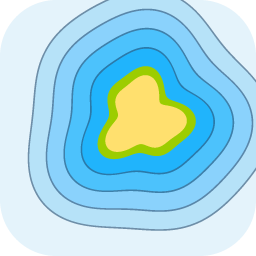
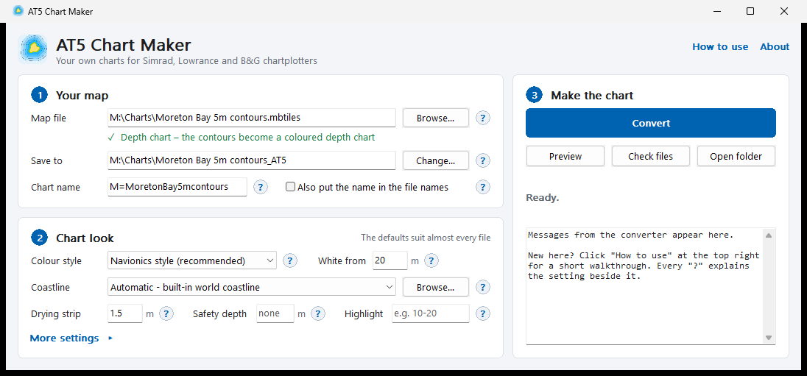
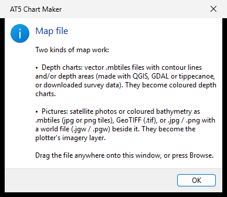
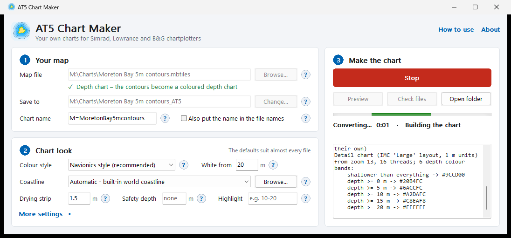
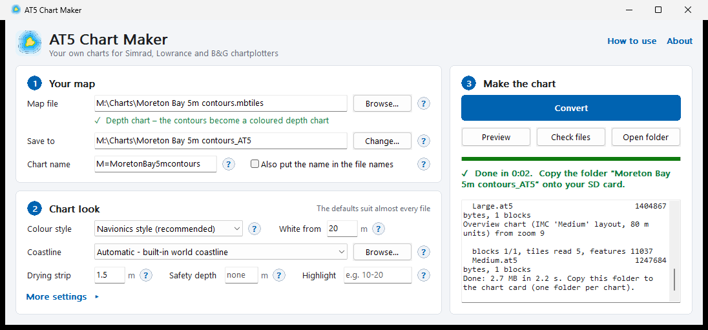
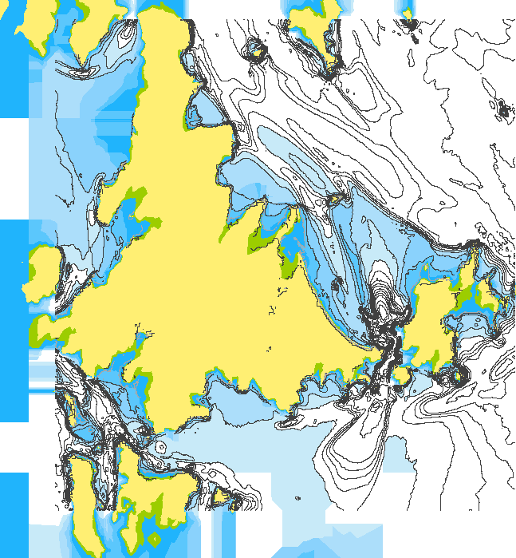
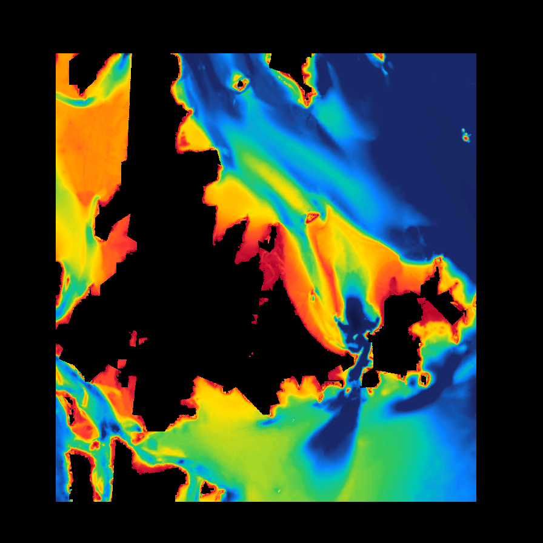

<p align="center"></p>

<h1 align="center">AT5 Chart Maker</h1>

<p align="center">Make your own charts for <b>Simrad, Lowrance and B&amp;G</b> chartplotters, from depth contours, satellite pictures or bathymetric maps.<br>
Free, works offline.</p>

<p align="center">
  
  
  
  
  
</p>

<p align="center"></p>

## What it does

- **Depth charts from contour lines.** 1 m, 5 m or any spacing, with or without depth areas. They're coloured like Navionics: tan land, a green drying strip, blue getting lighter with each contour, and white deep water. The colour edges sit exactly on the contour lines.
- **Satellite photos and coloured bathymetry.** These become the plotter's imagery / shaded-relief layer.
- **Bathymetry surveys on your sounder.** Turn a depth GeoTIFF into a coloured depth chart or a shaded-relief layer: see [Bathymetry charts on your sounder](#bathymetry-charts-on-your-sounder).
- **Built-in world coastline.** Land is drawn and the water is coloured right up to the shore, with extra detail around Australia. It switches off by itself for lakes and dams.
- **Fast.** All of Australia's 5 m contours convert in about 15 minutes; a bay takes seconds.
- **Same files as Navico's Insight Map Creator.** The output is `.at5` charts with the same names and layout, so you copy the folder to an SD card and the plotter reads it.

> **Not for navigation.** These are home-made charts. Always carry official charts.

## Download

1. Go to the **[Releases](../../releases)** page and download `AT5-Chart-Maker-1.0.zip`.
2. Unzip it anywhere and open the folder.
3. Double-click **`AT5 Chart Maker.exe`**.

You need Windows 10 or 11 (64-bit). The first time, Windows may say *"Windows protected your PC"*, because the program isn't signed by a big company. Click **More info**, then **Run anyway**.

## Make a chart in 4 steps

| | |
|---|---|
| **1. Choose your map.** Drag the file onto the window, or press Browse. The program works out what kind of map it is, and fills in where to save it and the chart's name. |  |
| **2. Pick the look.** The defaults suit almost every file. Every setting has a **?**: hover for a hint, click for the full explanation. |  |
| **3. Press Convert.** Progress shows on the right, and the button turns into **Stop** while it works. |  |
| **4. Copy the folder onto the SD card** (FAT32, 32 GB or smaller). On the plotter, choose **Lowrance / Insight** as the chart source. |  |

The program also has a step-by-step guide built in (**How to use**, top right). The full guide with every setting explained is in **[docs/HOW-TO.md](docs/HOW-TO.md)**.

## What files work

| Your file | Becomes |
|---|---|
| **Vector MBTiles** (`.mbtiles` with contour lines and/or depth areas), for example made with QGIS, GDAL or tippecanoe, or downloaded survey data | A coloured depth chart: `Large.at5` (detail) + `Medium.at5` (zoomed-out overview) |
| **Picture MBTiles** (jpg/png tiles), **GeoTIFF** (`.tif`), or **JPG/PNG with a world file** (`.jgw` / `.pgw`) | The plotter's imagery layer: `_3DTexture_16.at5`, `_3DTexture_32.at5` … |

Contour values can be depths (5, 10, 15) or heights (−5, −10, −15). It works out which on its own.

## Bathymetry charts on your sounder

Have a high-detail depth survey? Put it on your plotter. Any bathymetry GeoTIFF works, for
example one made with [BathyPicker](https://github.com/SeaBathy/BathyPicker) (10 m detail,
anywhere in Australian waters) or downloaded from a survey portal. There are two ways, and
you can load both on the card:

| | |
|---|---|
| **As a depth chart.** Draw depth contours from the survey and save them as vector MBTiles. AT5 Chart Maker colours the water between them like a proper chart, with land from the built-in coastline, a drying strip, and blues that step with each contour. |  |
| **As a shaded-relief picture.** Colour the survey by depth and save it as picture MBTiles. It becomes the plotter's imagery / shaded-relief layer, so every reef and channel shows in full colour under your chart. |  |

Both examples above are the Whitsundays, from a BathyPicker GeoTIFF. Both outputs pass
`sat2at5 verify`.

<details>
<summary><b>How to make the MBTiles (GDAL commands)</b></summary>

These use [GDAL](https://gdal.org), which comes free with QGIS and OSGeo4W (and BathyPicker
installs a copy). Depths below sea level are negative in IMAS and most surveys.

**Depth chart (contours):**

```bash
gdal_contour -a depth -fl -120 -100 -80 -60 -50 -40 -30 -25 -20 -15 -10 -5 -2 0 survey.tif contours.gpkg -nln contours
ogr2ogr -f MBTILES contours.mbtiles contours.gpkg -dsco MINZOOM=8 -dsco MAXZOOM=14
```

Open `contours.mbtiles` in AT5 Chart Maker; it is recognised as a depth chart. Pick your
contour levels to suit the area: closer together where it matters to you. On the command
line, add `--land auto` for the built-in coastline (the window does this by itself).

**Shaded-relief picture:** write a colour ramp file, `ramp.txt` (depth in metres, then red,
green, blue, alpha):

```text
nv 0 0 0 0
200 0 0 0 0
0.01 0 0 0 0
0 179 0 45
-3 255 59 48
-8 255 149 0
-14 255 224 0
-20 52 199 89
-26 0 200 180
-33 10 132 255
-45 27 42 107
-150 12 18 55
```

```bash
gdalwarp -t_srs EPSG:3857 -r bilinear survey.tif survey_3857.tif
gdaldem color-relief survey_3857.tif ramp.txt coloured.tif -alpha
gdal_translate -of MBTILES -co TILE_FORMAT=PNG coloured.tif bathymetry.mbtiles
gdaladdo -r average bathymetry.mbtiles 2 4 8 16 32
```

Open `bathymetry.mbtiles` in AT5 Chart Maker; it is recognised as a picture map. The same
two MBTiles files also open in [SeaBathy](https://github.com/SeaBathy/seabathy-android) on
your phone or PC.
</details>

## On the plotter

- **Chart source:** in the chart settings, choose **Lowrance / Insight** (not Navionics or C-MAP). For pictures, also turn on the **Imagery / Shaded relief** overlay.
- **SD card:** FAT32, 32 GB or smaller. Newer units are reported to read bigger cards formatted NTFS; exFAT is reported not to work.
- **Several charts:** give each chart its own folder on the card. Or tick **Also put the name in the file names** before converting, and then charts can share a folder.
- **Nothing shows?** Some older units only read files at the top of the card: copy the `.at5` files themselves (not the folder) to the top. Try a small chart first.

## Questions

**Is it safe?** It works offline and sends nothing anywhere. Each chart file stores only its own file name, the date and the chart name. Pick a neutral chart name before sharing charts.

**Which plotters?** Simrad, Lowrance and B&G units that read Insight / AT5 charts. The charts use Atlas version 12 with true-colour fills; units that don't support that may show different colours. Tested on a Simrad unit, where the charts load and show. Other models haven't been tried yet, so try a small chart on your own unit first.

**Can it run from the command line?** Yes. `program\sat2at5.exe` does everything the window does, for batch jobs. See **[docs/TECHNICAL.md](docs/TECHNICAL.md)**.

## Building from source

You need Visual Studio 2022 or its free Build Tools ("Desktop development with C++"), and Python 3 for the coastline data.

```bat
build.bat
python tools\fetch_coastlines.py
sh tools\make_package.sh
```

- **`build.bat`** makes `bin\sat2at5.exe` (the converter) and `bin\sat2at5_gui.exe` (the window program).
- **`fetch_coastlines.py`** downloads and packs the free coastlines (about 170 MB of downloads, once).
- **`make_package.sh`** builds the release folder and zip in `dist\`.

The code uses only what Windows already has: WIC for images, the built-in SQLite for MBTiles. There's nothing else to install.

## Credits and licences

- **Code:** MIT licence ([LICENSE](LICENSE)).
- **World coastline:** [GSHHG](https://www.soest.hawaii.edu/pwessel/gshhg/) 2.3.7, Wessel & Smith (University of Hawaii / NOAA), LGPL 3.
- **Australian coastline:** [GEODATA COAST 100K 2004](https://pid.geoscience.gov.au/dataset/ga/61395), © Commonwealth of Australia (Geoscience Australia), CC BY 4.0.

AT5 Chart Maker is an independent project. It is not affiliated with or endorsed by Navico, Simrad, Lowrance, B&G or Navionics; those names are trademarks of their owners and are used only to say which devices the charts are for.

Also from SeaBathy: [SeaBathy for Android](https://github.com/SeaBathy/seabathy-android), [SeaBathy Desktop](https://github.com/SeaBathy/seabathy-desktop) and [BathyPicker](https://github.com/SeaBathy/BathyPicker).
