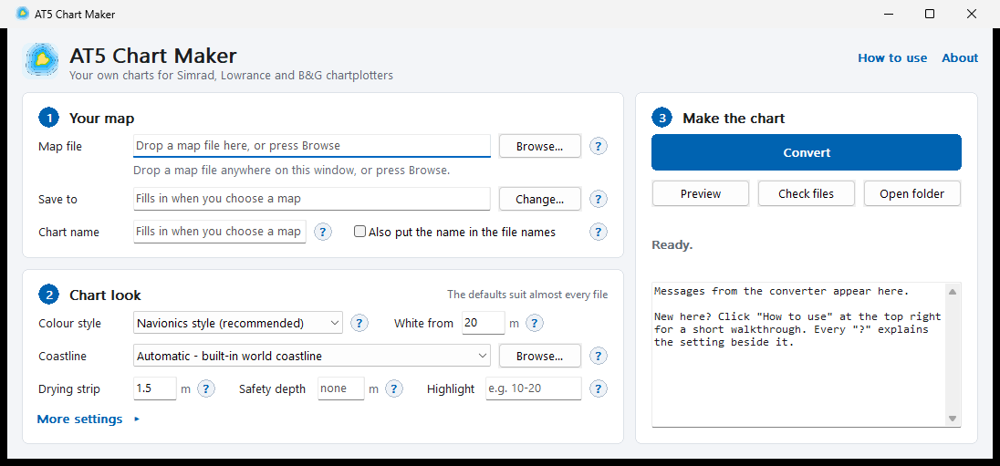
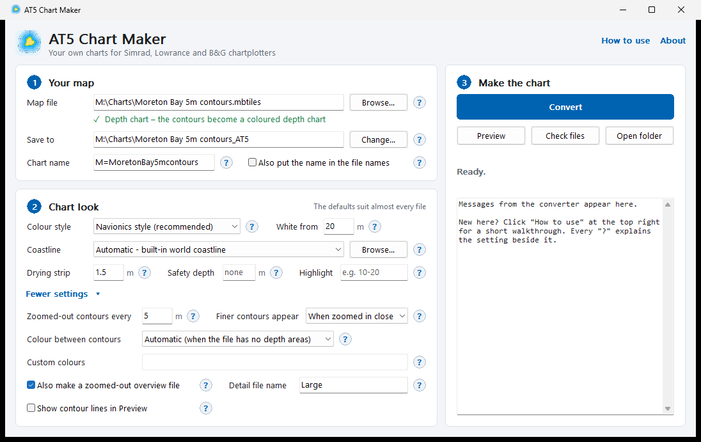
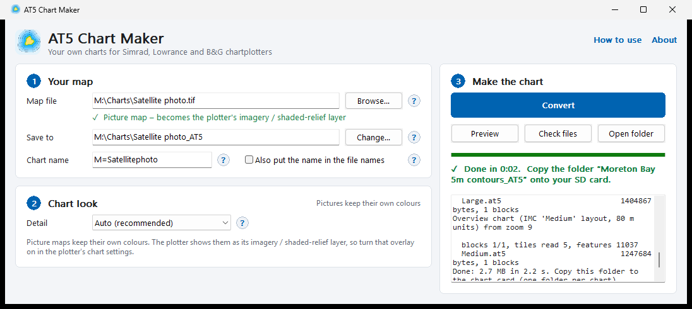
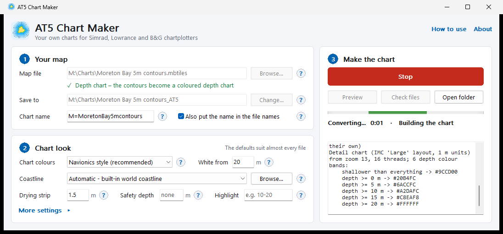
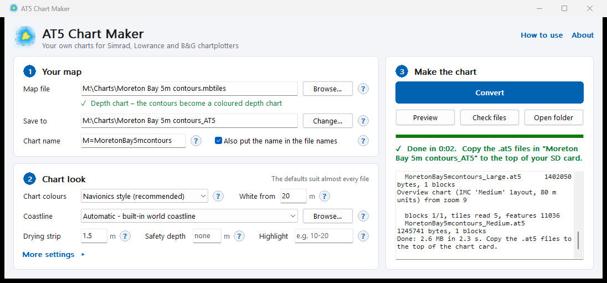

# How to use AT5 Chart Maker

This guide walks through making a chart, every setting in the window, and getting the chart onto your plotter. The same help is built into the program: **How to use** (top right) and the **?** beside every setting.

> **Not for navigation.** These are home-made charts. Always carry official charts.

## What you need

- **A PC:** Windows 10 or 11, 64-bit.
- **Your map file:** a depth-contour MBTiles file or a satellite / bathymetry picture (see [What files work](#what-files-work)).
- **A card:** an SD or microSD card of 32 GB or smaller, formatted FAT32.

## Starting the program

Unzip the download, open the **AT5 Chart Maker** folder and double-click **`AT5 Chart Maker.exe`**. Keep the folder together: the `program` folder inside holds the converter and the built-in coastlines.

If Windows says *"Windows protected your PC"*, click **More info**, then **Run anyway**. This happens because the program isn't signed by a big company, and only the first time.

The window has three steps:
1. **Your map:** what to convert and where the chart goes.
2. **Chart look:** colours and other settings. The defaults suit almost every file.
3. **Make the chart:** Convert, then Preview, Check files and Open folder. Messages from the converter appear underneath.

## Step 1: Your map

**Map file.** Drag your file anywhere onto the window, or press **Browse…**. The line underneath says what kind of map it is:
- *Depth chart*: the contours become a coloured depth chart.
- *Picture map*: it becomes the plotter's imagery / shaded-relief layer.
- In red, if the file can't be used, with the reason.

**Save to.** The folder the chart files go into. It fills in for you: next to your map file, ending in `_AT5`. Press **Change…** to pick another folder. Use a new folder for each chart. If the folder already holds an older chart, the program asks before replacing it, so old and new files never mix.

**Chart name.** A short name stored inside the chart files, which the plotter uses to tell your charts apart. It's filled in from the file name (for example `M=MoretonBay5m`); change it if you like. The name and the date are stored in the files, and nothing else about you or your PC is, so pick a neutral name before sharing charts.

**Also put the name in the file names.** Normally every chart uses the same file names (`Large.at5`, `_3DTexture_16.at5` …), so each chart needs its own folder on the card. Tick this and the name goes into the file names (`Cairns_Large.at5` …), so several charts can share one folder. This matches Insight Map Creator's "Project Based Naming".

## Step 2: Chart look

### Depth charts

| Setting | What it does |
|---|---|
| **Colour style** | **Navionics style** (recommended): tan land, green drying strip, blue getting lighter with every contour, white deep water. **Paper chart (S-52)**: the official electronic-chart day colours. **Soft blue**: gentle blue steps. **Custom**: your own colours (under More settings). |
| **White from** | Water deeper than this many metres is white. Shallower water gets one blue step per contour. Raise it (for example to 50) for more blue steps offshore. |
| **Coastline** | **Automatic** draws the land from the built-in world coastline (extra detail around Australia), so land is tan and water is coloured up to the shore. It switches itself off for inland charts. Choose **None** for lakes, dams and rivers, or **Browse…** for your own coastline shapefile (`.shp`). |
| **Drying strip** | The green strip along the shore that dries at low tide. Contour files rarely have a 0 m line, so it's estimated: the coast is taken to be this many metres above chart datum (default 1.5). 0 = no strip. |
| **Safety depth** | Optional. Water shallower than this is red, with a bold contour line, like a plotter's safety contour. |
| **Highlight** | Optional. A depth range in a stand-out colour, for example `10-20` for a favourite fishing depth. |

**More settings** opens the less-used options:

| Setting | What it does |
|---|---|
| **Zoomed-out contours every** | When zoomed out, only every Nth metre of contour lines is shown (default 5 m). All lines show when you zoom in. |
| **Finer contours appear** | When the in-between lines (for example 1 m) start to show as you zoom in. |
| **Colour between contours** | Most contour files only have lines. *Automatic* builds the coloured depth areas between the lines when the file has none of its own. |
| **Custom colours** | Used with the Custom style: `start depth : RRGGBB` pairs, for example `min:83B295, 0:73B6EF, 2:98C5F2, 5:BAD5E1, 10:D4EAEE` (`min` is the drying strip). |
| **Zoomed-out overview file** | Also makes `Medium.at5`, a small overview the plotter shows when zoomed far out. Keep it on. |
| **Detail file name** | The main chart file's name (`Large`, as Insight Map Creator names it). Leave it unless you know you need another. |
| **Contour lines in Preview** | Draws the lines in the Preview picture. With dense 1 m contours they can hide the colours, so it's off by default. |

### Depth surveys

A GeoTIFF of depths (for example from BathyPicker) becomes a coloured, shaded depth picture, with contour lines on top if you like.

| Setting | What it does |
|---|---|
| **Colours** | **Spectrum** (red in the shallows through yellow and green to deep blue; shows the most detail), **Lagoon**, **Thermal**, **Chart blues** or **Grey**. |
| **Depth range** | The depths the colours are spread over, for example `0-200`. Deeper water shows in the deepest colour. The colours bunch up where most of the seabed is, so a reef flat gets several colours instead of one. A small range (say `0-30`) shows reefs and shallows in much more detail; a big one (`0-2000`) shows the whole drop-off. Empty = automatic, from 0 to about the deepest water in the survey. |
| **Hillshade** | Shading that makes the seabed look 3D, on the same scale as the SeaBathy apps: Off, 0.5x, 1x (recommended), 2x, 3x, 4x, 6x, 8x, 10x, 15x, 20x, 30x or 50x. Stronger makes the slopes steeper and darker, so smaller bumps and ledges show: try 2x to 4x for flat reef tops and sandy bottoms. The light comes mostly from the north-west, with some from the west, north and south-west, so walls facing any way keep their shape. |
| **Also make contour lines every** | Ticked: contour lines, labelled with their depth, as a depth chart in the same folder. Pick or type one number for a line every that many metres (`1` gives every metre), `auto` for 2, 5, 10, 15, 20 m …, or a list such as `2,5,10,20` for exactly those depths and no others. A spacing is used in the shallows and widens by itself in deep water (5 m past 50 m, 10 m past 200 m, 50 m past 500 m, 100 m past 1000 m), like a paper chart. |
| **Chart colours** | How the water between the contour lines is coloured. **Navionics style** (recommended) gives a green drying strip and a blue step at every line, lighter with depth, white from the **White from** depth; finer lines mean more colour steps. **Paper chart (S-52)** has four fixed bands (0, 2, 5 and 10 m). **Soft blue** is a gentle gradient. |
| **Finer contours** | When the lines in between the 5 m ones (for example every 1 m) appear as you zoom in on the plotter. Depth surveys start at **From medium zoom**; **When zoomed in close** matches Insight Map Creator; **Always** shows every line at every zoom. |
| **Drying strip** | Water shallower than this many metres is drawn green, as it dries at low tide (default 1.5 m). Surveys such as IMAS's are measured from mean sea level, so with a 2–3 m tide (the Great Barrier Reef) about 1.5 m dries at low spring tide; use less where tides are small, or 0 for green only above sea level. |
| **Coastline** | Land drawn with the contour lines, as for depth charts. |

With contour lines ticked, the lines are drawn into the picture too, so they show with the photo overlay on. They also come as a depth chart (labelled lines, coloured water) for when the overlay is off.

On **Simrad** (NSS, NSO, GO …): **Chart options → Photo overlay → Full**. *Land only* hides the picture over water. **Photo transparency** lets the chart show through the picture.

### Pictures

Picture maps keep their own colours, so there is one setting:

**Detail.** How sharp the picture is when zoomed right in. *Auto* uses the detail your file has. Choosing finer than the file doesn't add detail; it only makes bigger files.

## Step 3: Make the chart

Press **Convert**. A small area takes seconds; a whole country can take 10–15 minutes. You can keep using your PC, and the button becomes **Stop** if you want to cancel. A stopped conversion leaves nothing behind.

When it says **Done**:
- **Preview** opens a picture of the finished chart.
- **Check files** tests the chart files. It should report no problems.
- **Open folder** shows the files.

If something goes wrong, the status line turns red, and the messages underneath say why: for example, a file that isn't a map, or a picture without location information.

## Putting the chart on the plotter

1. Copy the whole output folder (for example `Moreton Bay 5m contours_AT5`) onto the SD card. Rename the folder if you like, but **don't rename the files inside it**.
2. Put the card in the plotter. In the chart settings, choose **Lowrance / Insight** as the chart source (not Navionics or C-MAP).
3. For satellite or bathymetry pictures, also turn on the photo layer. On **Simrad** (NSS, NSO, GO …): **Chart options → Photo overlay → Full**. *Land only* hides the picture over water. **Photo transparency** lets the chart show through the picture. On Lowrance and older units it's **Imagery** or **Shaded relief**.

**Several charts on one card:** give each chart its own folder. Or tick *Also put the name in the file names* before converting, and then charts can share a folder.

**Card size:** FAT32 cards of 32 GB or smaller are the safe choice. FAT32 can't hold a file over 4 GB, but the program splits big charts into files of about 450 MB. Newer plotters are reported to read bigger cards formatted NTFS; exFAT is reported not to work.

## What files work

| Your file | Becomes |
|---|---|
| **Depth GeoTIFF** (`.tif` of depths or heights, for example from BathyPicker) | A coloured, shaded depth picture (imagery layer) + contour lines (`Large.at5` / `Medium.at5`) if ticked |
| **Vector MBTiles** with contour lines and/or depth areas | A coloured depth chart: `Large.at5` (detail) + `Medium.at5` (zoomed-out overview) |
| **Picture MBTiles** (jpg/png tiles), **GeoTIFF** (`.tif`), or **JPG/PNG + world file** (`.jgw` / `.pgw`) | The plotter's imagery layer: `_3DTexture_16.at5`, `_3DTexture_32.at5` … |

Contour MBTiles can come from QGIS, GDAL (`gdal_contour`) with tippecanoe, or survey data downloads. Contour values can be depths or heights; the program works out which.

## Tips and fixes

- **Nothing shows on the plotter.** Check the chart source is Lowrance / Insight and the card is FAT32. Some older units only read files at the top of the card: copy the `.at5` files themselves to the top.
- **The land covers my lake.** Choose Coastline: **None** for lakes, dams and rivers. (Automatic usually notices by itself.)
- **"Windows protected your PC".** Click More info, then Run anyway.
- **Try a small area first,** before converting a whole country.
